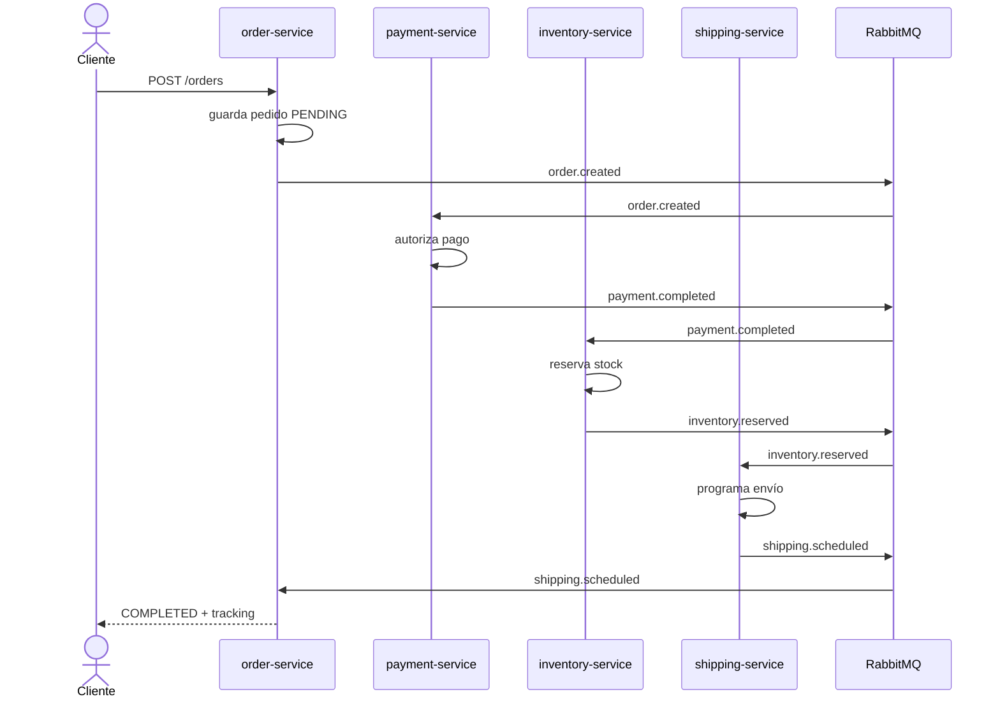
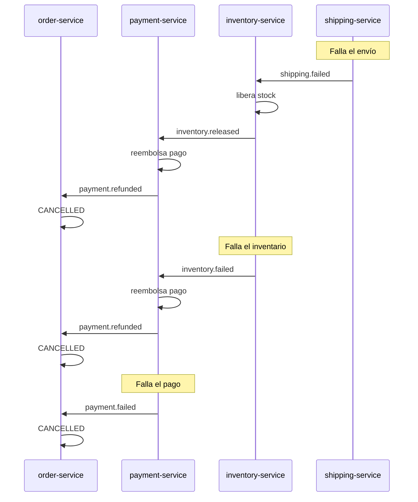

# SAGA por Coreografía en Go

Implementación académica de una **transacción distribuida** para un flujo de
e-commerce usando el patrón **SAGA por Coreografía**. Cada servicio tiene su
propia base de datos, publica y consume eventos en RabbitMQ y **no existe un
orquestador central**.

Flujo principal:

```text
Pedido → Pago → Inventario → Envío
```

Tecnologías: **Go 1.23**, `net/http`, `log/slog`, PostgreSQL, RabbitMQ,
Prometheus, Grafana, Docker/Podman y GitHub Actions.

## Arquitectura

### Flujo feliz



### Compensaciones



La compensación es **hacia atrás**: cada servicio que ya ejecutó una acción
escucha el fallo de un paso posterior y publica su propio evento compensatorio.
`order-service` es el único que conoce el estado final del pedido, pero no
ordena a los demás qué hacer: solo reacciona a los eventos.

## Servicios

| Servicio | Responsabilidad | Base de datos | Puerto |
|---|---|---|---|
| `order-service` | Crea pedidos por REST y mantiene su estado/read model | `orders` | `8081` |
| `payment-service` | Cobra y reembolsa | `payments` | `8082` |
| `inventory-service` | Reserva y libera stock | `inventory` | `8083` |
| `shipping-service` | Programa envíos | `shipping` | `8084` |

Además: RabbitMQ (`5672`, UI `15672`), PostgreSQL (`5433` en el host),
Prometheus (`9090`) y Grafana (`3000`).

## Eventos y colas

Exchange topic durable: `saga.events`.

| Routing key | Productor | Consumidor |
|---|---|---|
| `order.created` | order | payment |
| `payment.completed` | payment | inventory, order |
| `payment.failed` | payment | order |
| `payment.refunded` | payment | order |
| `inventory.reserved` | inventory | shipping, order |
| `inventory.failed` | inventory | payment, order |
| `inventory.released` | inventory | payment |
| `shipping.scheduled` | shipping | order |
| `shipping.failed` | shipping | inventory, order |

Cada servicio tiene una cola durable (`<servicio>.queue`), binding solo a las
routing keys que necesita, `prefetch=1`, ack manual, 3 reintentos con backoff y
DLQ (`saga.dlx` + `<cola>.dlq`).

El sobre común (`pkg/events`) contiene:

```json
{
  "event_id": "uuid",
  "saga_id": "uuid",
  "order_id": "uuid",
  "type": "payment.completed",
  "timestamp": "2026-11-12T01:00:00Z",
  "payload": {}
}
```

`event_id` se usa para idempotencia; `saga_id` correlaciona toda la traza.

## Estructura del proyecto

```text
saga-choreography-go/
├── deploy/postgres/init.sql     # crea las 4 bases lógicas
├── docs/                        # evidencias, extractos, Windows y guía de ejecución
├── monitoring/
│   ├── prometheus.yml
│   └── grafana/dashboards/saga.json
├── pkg/                         # infraestructura compartida
│   ├── broker/                  # publicador, consumidor, DLQ, reintentos
│   ├── config/                  # variables de entorno
│   ├── events/                  # sobre y routing keys
│   ├── httpx/                   # respuestas JSON y health
│   ├── metrics/                 # contadores Prometheus
│   └── postgres/                # conexión, migración e idempotencia
├── scripts/
│   ├── e2e.sh                   # 4 escenarios (Linux/macOS)
│   ├── e2e.ps1                  # 4 escenarios (Windows/PowerShell)
│   ├── e2e.cmd                  # wrapper para Windows
│   ├── saga.ps1                 # comandos tipo Makefile en PowerShell
│   ├── saga.cmd                 # wrapper para Windows
│   ├── trace.sh                 # traza legible de una saga (Linux/macOS)
│   ├── trace.ps1                # traza legible de una saga (Windows)
│   └── trace.cmd                # wrapper para Windows
├── services/
│   ├── order-service/
│   │   ├── cmd/main.go
│   │   ├── internal/
│   │   │   ├── domain/          # Order y transiciones
│   │   │   ├── application/     # CreateOrder, EventHandler
│   │   │   ├── ports/           # repositorio, publicador, métricas
│   │   │   └── adapters/
│   │   │       ├── http/        # API REST
│   │   │       ├── messaging/   # adaptador RabbitMQ
│   │   │       └── persistence/ # repositorio PostgreSQL
│   │   └── Dockerfile
│   ├── payment-service/         # misma estructura hexagonal
│   ├── inventory-service/
│   └── shipping-service/
├── docker-compose.yml
├── docker-compose.windows.yml   # override sin SELinux para Windows
├── docker-compose.sonar.yml
├── Makefile
├── .env.example
├── sonar-project.properties
└── .github/workflows/ci.yml
```

Las capas `domain` y `application` no importan `adapters` ni paquetes de
infraestructura. Los adaptadores implementan las interfaces de `ports`.

## Requisitos

- Go 1.22 o superior (probado con Go 1.23).
- Docker con Compose o Podman con `podman-compose`.
- **Linux/macOS:** `make`, `curl` y `python3` para los scripts de demo.
- **Windows:** Docker Desktop con contenedores Linux y PowerShell 5.1+. No se
  necesita `make`, Bash ni Python.

## Cómo ejecutar

### Linux / macOS

```bash
cp .env.example .env
make up
make ps
```

`make up` detecta automáticamente `docker compose`, `podman-compose` o
`podman compose`. El primer arranque construye las 4 imágenes y espera los
healthchecks de PostgreSQL y RabbitMQ.

### Windows con Docker Desktop

```powershell
Copy-Item .env.example .env
.\scripts\saga.cmd up
.\scripts\saga.cmd ps
```

El helper usa automáticamente `docker-compose.yml` +
`docker-compose.windows.yml` (este último elimina la etiqueta SELinux `,Z`,
que no aplica en Windows). También se puede ejecutar directamente:

```powershell
docker compose -f docker-compose.yml -f docker-compose.windows.yml up -d --build
```

Guía detallada y solución de problemas:
[`docs/windows.md`](docs/windows.md).

URLs:

| Recurso | URL | Credenciales |
|---|---|---|
| API de pedidos | http://localhost:8081/orders | — |
| RabbitMQ Management | http://localhost:15672 | `guest` / `guest` |
| Prometheus | http://localhost:9090 | — |
| Grafana | http://localhost:3000 | `admin` / `admin` |
| Health order | http://localhost:8081/health | — |
| Metrics order | http://localhost:8081/metrics | — |

Los otros servicios exponen `/health` y `/metrics` en `8082`, `8083` y `8084`.

Para detener y borrar volúmenes:

```bash
make down
```

## API REST

Crear un pedido:

```bash
curl -s -X POST http://localhost:8081/orders \
  -H 'Content-Type: application/json' \
  -d '{
    "customer": "Ana Torres",
    "product": "phone",
    "quantity": 1,
    "unitPrice": 400,
    "address": "Av. Siempre Viva 742"
  }'
```

Consultar un pedido:

```bash
curl -s http://localhost:8081/orders/<order_id>
```

Listar pedidos:

```bash
curl -s http://localhost:8081/orders
```

La respuesta incluye `id`, `sagaId`, `status`, `amount`, `tracking`, `reason`,
`createdAt` y `updatedAt`.

## Escenarios de demostración

Todos los escenarios se ejecutan con el stack levantado:

```bash
make demo-ok
make demo-payment-fail
make demo-inventory-fail
make demo-shipping-fail
```

En Windows:

```powershell
.\scripts\saga.cmd demo-ok
.\scripts\saga.cmd demo-payment-fail
.\scripts\saga.cmd demo-inventory-fail
.\scripts\saga.cmd demo-shipping-fail
```

| Escenario | Payload / causa | Resultado esperado |
|---|---|---|
| Éxito | `phone`, 1 unidad, `unitPrice=400` | `COMPLETED` + `TRK-<order_id>` |
| Fallo de pago | total `1500` > `MAX_PAYMENT_AMOUNT=1000` | `CANCELLED`, motivo del límite |
| Fallo de inventario | `laptop` con `quantity=99` | `CANCELLED`, stock insuficiente |
| Fallo de envío | `address="direccion invalid"` | `CANCELLED`, dirección inválida; pasa por `shipping.failed → inventory.released → payment.refunded` |

También se puede usar el script directo:

```bash
./scripts/e2e.sh ok
SCENARIO=shipping-fail ./scripts/e2e.sh
```

Después de cada escenario se puede restaurar el stock y limpiar tablas sin
borrar contenedores:

```bash
make reset
```

### Inyección de fallos por variables

Editar `.env` y recrear los servicios, o exportar antes de `make up`:

| Variable | Servicio | Efecto |
|---|---|---|
| `FAIL_PAYMENT=true` | payment | Rechaza siempre el pago |
| `FAIL_INVENTORY=true` | inventory | Rechaza siempre la reserva |
| `FAIL_SHIPPING=true` | shipping | Rechaza siempre el envío |
| `MAX_PAYMENT_AMOUNT=1000` | payment | Rechaza montos mayores al límite |
| `BLOCKED_CUSTOMER=blocked` | payment | Rechaza al cliente indicado |

También hay reglas de negocio sin variables: stock insuficiente y dirección que
contenga `invalid`.

## Pruebas

```bash
make test          # unitarias
make cover         # unitarias con -race + cobertura total
make cover-core    # solo domain + application
make integration   # requiere el compose levantado
```

Resultados verificados en este entorno:

| Paquete | Cobertura |
|---|---|
| `order-service/internal/application` | 79.3% |
| `payment-service/internal/application` | 79.4% |
| `inventory-service/internal/application` | 85.7% |
| `shipping-service/internal/application` | 82.4% |
| Dominios de los 4 servicios | 98–100% |
| **Cobertura de `domain` + `application`** | **87.3%** |
| Cobertura total del repositorio | 33.0% |

La cobertura total es menor porque `cmd`, `adapters` y los `ports` no tienen
pruebas unitarias; se validan con pruebas de integración y E2E. El requisito del
70% se cumple en `domain` y `application`.

Pruebas de integración incluidas:

- `pkg/broker/broker_integration_test.go`: publica y consume un evento real en
  RabbitMQ con cola/exchange temporales.
- `services/order-service/internal/adapters/persistence/order_repository_integration_test.go`:
  ejecuta migración, `Create`, `Get`, `Update` y `List` contra PostgreSQL real.

### Tabla caso de uso vs prueba

| Caso de uso | Prueba principal |
|---|---|
| Crear pedido y publicar `order.created` | `TestCreateOrderSuccess`, `TestCreateOrderValidation` |
| Validaciones del pedido | `TestNewOrderValidation` |
| Transiciones felices del pedido | `TestOrderHappyTransitions`, `TestEventHandlerHappyFlow` |
| Cancelación por pago fallido | `TestEventHandlerPaymentFailed` |
| Cancelación por reembolso | `TestEventHandlerPaymentRefunded`, `TestRefundPayment` |
| Compensación por inventario/envío | `TestEventHandlerCompensating` |
| Cobro exitoso | `TestChargeOrderSuccess` |
| Reglas de rechazo de pago | `TestChargeOrderFailures` |
| Reserva de stock | `TestReserveStockSuccess` |
| Stock insuficiente / fallo inyectado | `TestReserveStockFailures` |
| Liberación de stock | `TestReleaseStockSuccess` |
| Programación de envío | `TestScheduleShipmentSuccess` |
| Dirección inválida / fallo inyectado | `TestScheduleShipmentFailures` |
| Persistencia PostgreSQL | `TestOrderRepositoryIntegration` |
| Mensajería RabbitMQ | `TestPublisherConsumerIntegration` |
| Flujo completo por REST y eventos | `scripts/e2e.sh` / `scripts/e2e.ps1` (4 escenarios) |

## Observabilidad

Cada servicio expone `/metrics` con contadores Prometheus:

- `saga_events_published_total`
- `saga_events_consumed_total`
- `saga_events_failed_total`
- `saga_sagas_started_total`
- `saga_sagas_completed_total`
- `saga_sagas_compensated_total`

Prometheus scrapea los 4 servicios. El dashboard de Grafana se provisiona
automáticamente desde `monitoring/grafana/dashboards/saga.json` y muestra
eventos por servicio y sagas completadas vs. compensadas.

Los logs son JSON con `saga_id`, `order_id`, `event_id`, evento recibido, acción
ejecutada y evento publicado. Para seguir una saga:

```bash
docker compose logs -f order-service payment-service inventory-service shipping-service
# o
make logs
```

Para ver una traza resumida y ordenada por tiempo:

```bash
make trace
ORDER_ID=<order_id> make trace
./scripts/trace.sh <order_id>
```

En Windows:

```powershell
.\scripts\trace.cmd
.\scripts\trace.cmd <order_id>
.\scripts\saga.cmd trace <order_id>
```

## CI y SonarQube

`.github/workflows/ci.yml` ejecuta en cada push/PR:

1. `go vet ./...`
2. `golangci-lint`
3. `go test -race -covermode=atomic -coverprofile=coverage.out ./...`
4. Construcción de las 4 imágenes Docker.

SonarQube es opcional:

```bash
make sonar
# UI: http://localhost:9000
make sonar-down
```

La configuración está en `sonar-project.properties` y consume `coverage.out`.

## Decisiones de diseño y limitaciones

- **Un módulo Go raíz** en lugar de un módulo por servicio o `go.work`. Se
  eligió para simplificar la construcción y el CI; la separación lógica se
  mantiene por servicio.
- **Una instancia PostgreSQL con cuatro bases lógicas** (`orders`, `payments`,
  `inventory`, `shipping`). Cumple database-per-service a nivel lógico sin
  multiplicar contenedores.
- **`order-service` consume también `payment.completed` e `inventory.reserved`**
  además de los eventos de fallo. Así mantiene un read model coherente y puede
  mostrar el estado intermedio en la API; no es un orquestador.
- **Idempotencia** con tabla `processed_events`: se marca el `event_id` antes de
  ejecutar el handler y se desmarca si el procesamiento falla. Los handlers
  están diseñados para ser idempotentes; la marca y la escritura de negocio no
  comparten una única transacción distribuida.
- **Reintentos y DLQ**: 3 intentos en memoria con backoff; si falla, `nack` sin
  requeue hacia `saga.dlx`. Los mensajes ilegibles también van a DLQ.
- **RabbitMQ en Podman rootless**: el entrypoint oficial baja al usuario
  `rabbitmq`, pero el volumen del broker queda sin permisos. Para la demo se
  arranca `rabbitmq-server` directamente con `user: "0:0"`. En Docker también
  funciona, aunque ejecutar el broker como root no es ideal para producción.
- **Windows/Docker Desktop** usa `docker-compose.windows.yml` para quitar el
  sufijo SELinux `,Z` de los bind mounts. El flujo principal se validó con
  Podman; la variante Windows se deja preparada para Docker Desktop.
- **SonarQube no se ejecutó** en este entorno; el compose y la configuración
  quedaron listos.
- **Cobertura total 33%**: los adaptadores y `cmd` se validan con integración y
  E2E, no con unitarias. La métrica relevante para el requisito es 87.3% en
  `domain` + `application`.

## Comandos útiles

### Linux / macOS

```bash
make help
make up
make ps
make logs
make test
make cover
make cover-core
make integration
make trace
make demo-ok
make demo-payment-fail
make demo-inventory-fail
make demo-shipping-fail
make reset
make down
make sonar
make sonar-down
```

### Windows / PowerShell

```powershell
.\scripts\saga.cmd help
.\scripts\saga.cmd up
.\scripts\saga.cmd ps
.\scripts\saga.cmd logs
.\scripts\saga.cmd test
.\scripts\saga.cmd cover
.\scripts\saga.cmd cover-core
.\scripts\saga.cmd integration
.\scripts\saga.cmd trace
.\scripts\saga.cmd demo-ok
.\scripts\saga.cmd demo-payment-fail
.\scripts\saga.cmd demo-inventory-fail
.\scripts\saga.cmd demo-shipping-fail
.\scripts\saga.cmd reset
.\scripts\saga.cmd down
.\scripts\saga.cmd sonar
.\scripts\saga.cmd sonar-down
```

## Evidencias y extractos

- Guía de captura paso a paso: [`docs/evidencias.md`](docs/evidencias.md)
- Fragmentos representativos explicados: [`docs/extractos-codigo.md`](docs/extractos-codigo.md)
- Guía para Windows + Docker Desktop: [`docs/windows.md`](docs/windows.md)
- Guía completa para el compañero: [`docs/como-ejecutar.md`](docs/como-ejecutar.md)
